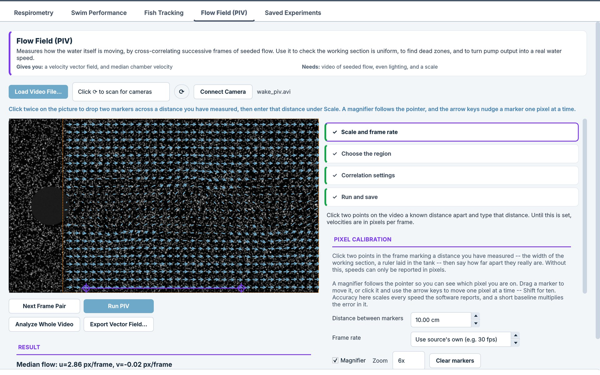
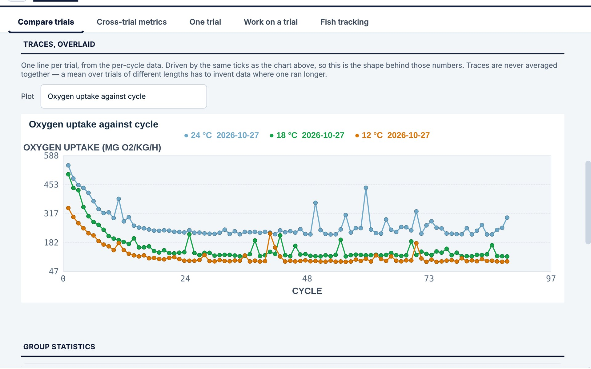
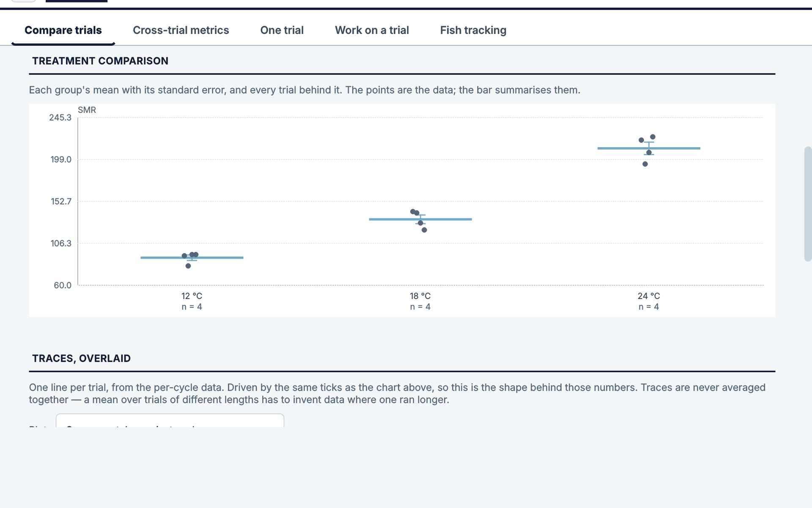
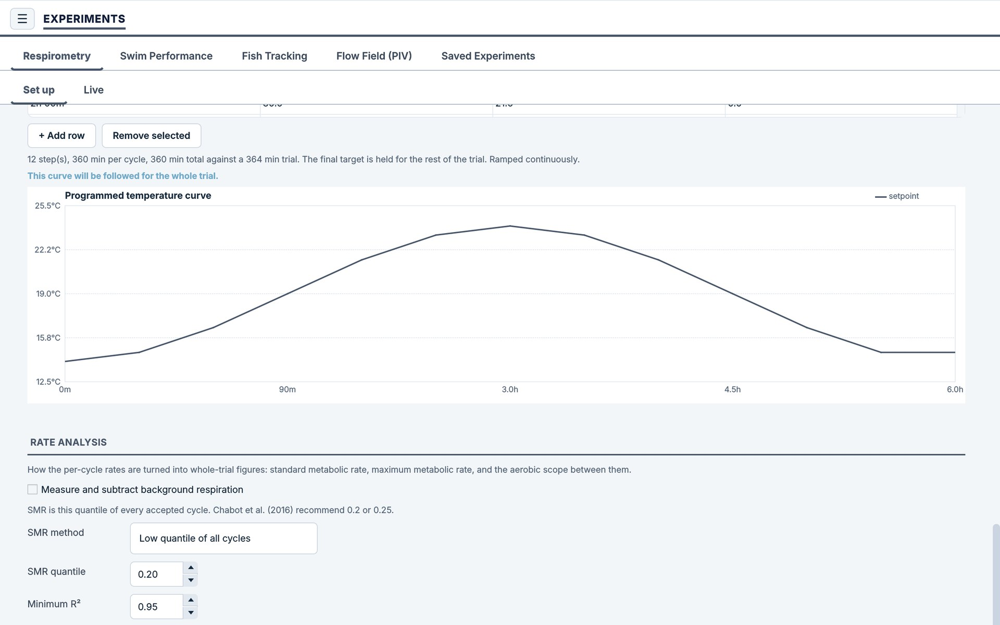
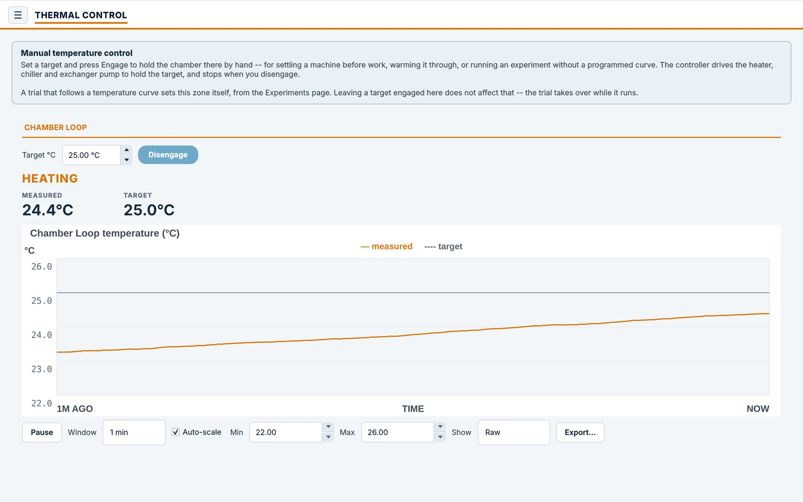
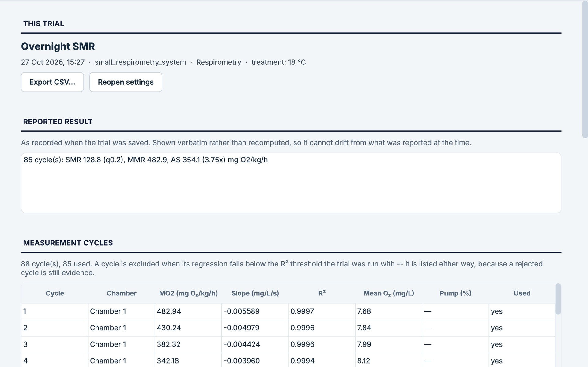
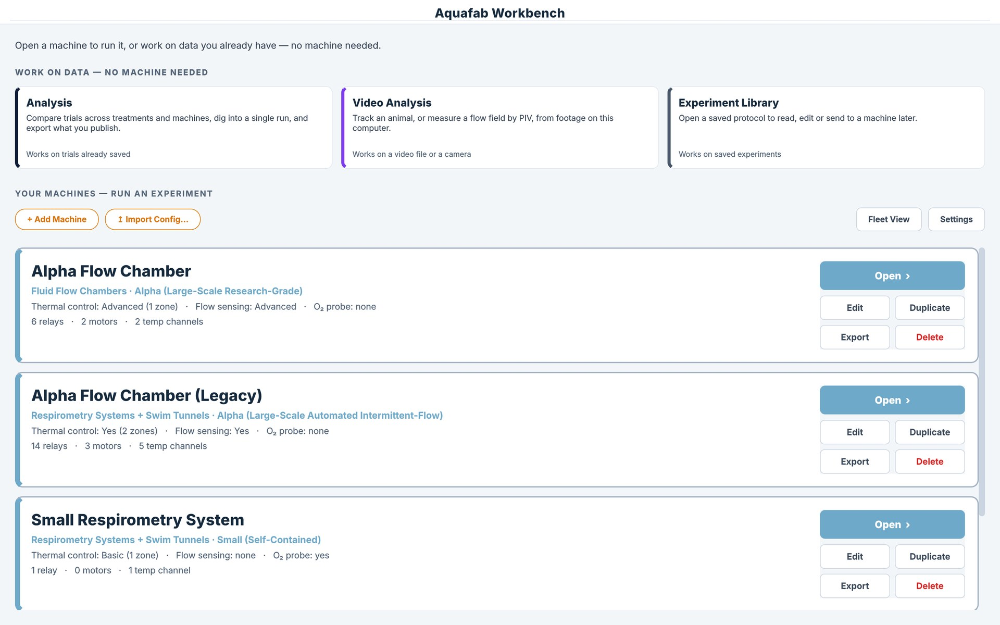

# Aquafab Workbench — releases

Installers for **Aquafab Workbench**, the control, monitoring and analysis
software for Aquafab Industries flow chambers, respirometry systems, swim
tunnels and life-support racks.

This repository holds **installers only**. The source code is private and is not here.

## Download

Get the latest version from the Aquafab website. No account is needed to download it:

**<https://aquafabindustries.com/pages/aquafab-workbench#downloads>**

| Platform | Installer |
| --- | --- |
| Windows 10/11 (64-bit) | `AquafabWorkbench-Windows.exe` |
| Mac with Apple silicon (M1 or later) | `AquafabWorkbench-macOS.dmg` |
| Mac with an Intel processor | `AquafabWorkbench-macOS-Intel.dmg` |
| Linux (x86-64) | `AquafabWorkbench-Linux.AppImage` |

Raspberry Pi control computers are set up by Aquafab. Contact
[support](mailto:sales@aquafabindustries.com) if yours needs reinstalling.

Each release lists what changed in its notes on the
[Releases](../../releases) page.

## User guides

PDF guides, updated as the software changes. These links always point at the
newest edition.

| Guide | PDF |
| --- | --- |
| The complete user guide: every page, control and procedure | [Aquafab Workbench User Guide](guides/Aquafab-Workbench-User-Guide.pdf) |
| Download, install, activate, find your way around | [Getting Started](guides/Aquafab-Workbench-Getting-Started.pdf) |
| Codes, seats and the license dashboard | [Managing Your Lab's Licenses](guides/Aquafab-Workbench-Managing-Licenses.pdf) |
| Checking and calibrating a new machine | [Commissioning a New Machine](guides/Aquafab-Workbench-Commissioning.pdf) |
| SMR, MMR, aerobic scope, Pcrit | [Running a Respirometry Trial](guides/Aquafab-Workbench-Respirometry-Trial.pdf) |
| Tidal cycles, ramps, recorded traces | [Running a Temperature Program](guides/Aquafab-Workbench-Temperature-Program.pdf) |
| Camera setup, flow fields, pump-to-velocity calibration | [PIV Flow Measurement and Chamber Velocity Calibration](guides/Aquafab-Workbench-PIV-Flow-Calibration.pdf) |
| The stepped-velocity Ucrit test | [Swim Performance Testing](guides/Aquafab-Workbench-Swim-Performance.pdf) |
| Following an animal through video | [Fish Tracking](guides/Aquafab-Workbench-Fish-Tracking.pdf) |
| Comparing treatments, re-analysing, exporting | [Analysing and Exporting Results](guides/Aquafab-Workbench-Analysis.pdf) |

`guides/guides.json` lists each guide with the software version and edition
date it describes.

## Screenshots

| | |
| --- | --- |
|  |  |
|  |  |
|  |  |

Screenshots use simulated machines and modelled example data: the trout
respirometry trials and the cylinder-wake PIV recording were generated from
published physiology and textbook flow models, then analyzed by the software
itself. They are not measurements.

## Preview and license

Without a license, Aquafab Workbench is a preview: you can explore the
example machine, "Alpha Flow Chamber (Example)", which always runs simulated.
A license unlocks adding your own machines, PIV, fish tracking, trial
analysis, data export and trials on your own hardware. Every Aquafab machine
profile is already in the installer under **+ Add Machine**; the profile
files on the website are only for restoring or sharing a configuration, and
importing one needs a license.

A license comes with every Aquafab system. To use the software with your own
equipment, buy a lab license at
<https://aquafabindustries.com/products/aquafab-workbench-license>. Each
computer is activated once with its own code, and licenses never expire.

A license is never checked in a way that stops a trial, a pump or a heater
that is already running.

## Updates

When a new version is out, Aquafab Workbench shows **Update available** at
the top of the window. Press it, then **Download and install** in Settings.
The software downloads the new version, checks it against the published
checksum, closes, installs it and opens again. Your machines, calibrations
and trials are kept.

It never installs anything without you pressing the button, and it will not
update while a trial is running. You can also download the newest installer
from the website and install it over the old one.

## Support

- Website: <https://aquafabindustries.com/pages/support>
- Email: [sales@aquafabindustries.com](mailto:sales@aquafabindustries.com)
- Phone: +1 (513) 781-8010

Aquafab Workbench is laboratory control software. It is not a safety system,
and no interlock in it is rated or certified.

---

## For Aquafab: making a release

Releases are published automatically. Pushing a `vX.Y.Z` tag to the private
source repository builds every installer and creates the release here, with
`version.json` written from the files themselves. The steps and the token it
needs are in the source repository's `docs/PACKAGING.md`.

Each release carries the same file names. **Never rename them.** The website
links to `releases/latest/download/<name>`, which always serves the newest
release's file of that name.

| Asset | What it is |
| --- | --- |
| `AquafabWorkbench-Windows.exe` | Windows installer |
| `AquafabWorkbench-macOS.dmg` | Mac, Apple silicon |
| `AquafabWorkbench-macOS-Intel.dmg` | Mac, Intel |
| `AquafabWorkbench-Linux.AppImage` | Linux, x86-64 |
| `version.json` | Version, notes, and each file's SHA-256 |

Never put source code, license keys, the license signing key, or customer data
in this repository. It is public.
